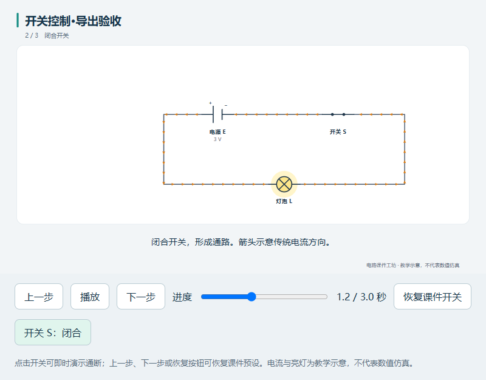

# 电路课件工坊 · Circuit Teacher

[](LICENSE) [](https://github.com/wytq-da88/circuit-teacher/actions/workflows/ci.yml)

**上传纸质电路照片 → 识别成可编辑电路 → 校对 → 用中文修改线路或讲解动画 → 导出交付。**

一个中文、本机运行的网页工作台，适合教师、培训机构和科普作者制作基础直流电路课件。工程、配置和成品保存在程序目录内。可手动编辑，也可接入你自己的视觉 API。

当前为 **v0.1.0 公开预览版**。真实照片识别的准确率尚待使用可用视觉 API 实测；内置案例是人工模板。电流、灯泡和开关动画属于教学示意，不计算真实电流、电压或波形。



## 下载与启动

从 [v0.1.0 下载页](https://github.com/wytq-da88/circuit-teacher/releases/tag/v0.1.0) 下载 `circuit-teacher-v0.1.0-source.zip`。这是带启动脚本的源码包；需要 **Node.js 22 或更新版本**，推荐 Node.js 24。下载包不含 Node.js、API 账户、浏览器或 FFmpeg。

Windows：

1. 安装 [Node.js](https://nodejs.org/)。
2. 解压到可写目录，例如 `D:\workspace\circuit-teacher`。
3. 首次运行双击 `setup.cmd`，联网安装依赖并构建网页。
4. 双击 `start.cmd`。启动器会复用已有服务，找到本机浏览器后打开工作台；也可手动访问 **http://127.0.0.1:4317/**。

使用 Git 或在 macOS/Linux 上运行：

```sh
git clone https://github.com/wytq-da88/circuit-teacher.git
cd circuit-teacher
npm ci
npm run build
npm start
```

Windows PowerShell 如果禁止执行 `npm.ps1`，请用 `npm.cmd` 替代 `npm`。首次安装需要网络；安装完成后，手动编辑与本地课件播放无需 AI 服务。PNG/PDF/MP4 所需工具见下文。

## 功能与制作流程

支持单张 PNG/JPG/WebP 图片（不超过 10MB）、裁剪和旋转；一个工程最多 30 个元件，包括电源、开关、电阻、滑动变阻器、灯泡、电流表、电压表和导线。

1. 打开“串联电路”“并联电路”或“开关控制”案例，体验拖动元件、修改数值、重接导线和播放。
2. 上传照片。在“AI 设置”配置兼容视觉 API 后识别；对照原图检查极性、数值、引脚和接点，逐项处理待确认项。
3. 导线只有共享端点或明确接点才连通；画面交叉不会自动连通。双击导线可添加折点。
4. 输入中文指令，选择“修改电路”或“修改演示”。查看变更提议后确认应用；支持撤销、重做和历史版本恢复。
5. 编辑讲解步骤、时长、字幕、高亮、电流方向、开关、灯泡和标签动作。改线路后会重新校验动画引用，问题修复后才能导出。
6. 校对确认后导出交付。工程 JSON 也可在校对前导出备份；重新导入后可以继续编辑。

电流方向按单个直流电源正极到负极的闭合外电路示意，断路停止箭头，电压表不作为通流支路。临时互动需保存为讲解步骤，才会进入视频。

## 导出格式

| 格式 | 内容 | 额外依赖 |
| --- | --- | --- |
| PNG | 当前选定画面，1920×1080 | 本机 Chrome/Edge 或 Chrome Headless Shell |
| SVG | 当前选定画面，矢量插图 | 无 |
| PDF | 当前选定画面，含中文 | 本机 Chrome/Edge 或 Chrome Headless Shell |
| 离线 HTML | 单文件，可断网播放、暂停、拖动进度和互动开关 | 播放时使用普通浏览器 |
| MP4 | 完整讲解时间轴，1920×1080、30 fps、中文字幕 | Chrome Headless Shell、FFmpeg、FFprobe |
| 工程 JSON | 电路、原图、讲解步骤及字幕，可再次导入 | 无 |

网页预览、离线 HTML 和视频共用场景与时间轴逻辑。导出文件保存在程序目录的 `exports/`；视频不含自动配音。

### 安装视频工具

1. 从 [FFmpeg 官方下载页面](https://ffmpeg.org/download.html) 选择适合系统的构建。将 `ffmpeg` 和 `ffprobe` 放到 `.tools/ffmpeg/bin/`（Windows 为 `.exe`），或加入系统 PATH。仓库不分发 FFmpeg 二进制。
2. 在程序目录运行：

```sh
npm run setup:video
```

该命令通过 HyperFrames 安装官方 Chrome Headless Shell 到本项目 `.cache/runtime/`，并检查浏览器和 FFmpeg。完成后重启工作台。Windows 的 Edge 可用于 PNG/PDF，视频建议使用上述 Headless Shell。

也可以通过进程环境变量指定工具的绝对路径或相对程序目录的路径：

| 变量 | 用途 |
| --- | --- |
| `CIRCUIT_BROWSER_PATH` | PNG/PDF 浏览器和 Windows 启动窗口 |
| `CIRCUIT_VIDEO_BROWSER_PATH` | 与 HyperFrames 兼容的视频浏览器 |
| `CIRCUIT_FFMPEG_PATH` | FFmpeg 可执行文件 |
| `CIRCUIT_FFPROBE_PATH` | FFprobe 可执行文件 |

Linux ARM64 需要自行安装 Chromium 并设置视频浏览器路径。系统字体也会影响中文显示，Linux 请安装中文字体（如 Noto Sans CJK）。

## AI 与本地数据

需要支持 `/chat/completions`、图片消息和 JSON 文本输出的兼容 API。仅文本模型不能识图。连接测试会真实调用配置的服务，费用由该服务决定；本项目不附带 API 密钥或额度。

识别时，图片会发送到你配置的 API；中文修改时，会发送结构化工程与指令。AI 返回的数据先校验并预览，不执行模型生成的脚本。API 超时、错误 JSON 或无效引用不会覆盖当前成果。

密钥保存在本机 `data/` 配置文件中，**未加密**，不通过配置读取接口回传，也不写入工程导出或运行日志。不要分享 `data/`。导出的工程 JSON 含原图，分享前请检查图片内容。

| 程序目录下的路径 | 用途 |
| --- | --- |
| `data/` | 本机设置、工程、版本记录和使用统计 |
| `exports/` | 成品、视频作业和渲染诊断 |
| `logs/` | 运行日志 |
| `.cache/` | 依赖、浏览器缓存和临时文件 |
| `.tools/` | 自行配置的外部工具 |

以上目录均由 Git 忽略。服务只监听 `127.0.0.1:4317`，首版适用于本机个人使用。多电源、交流、复杂电子器件和专业 PCB/数值仿真不在首版支持范围内。

## 开发与贡献

React + TypeScript + Vite + React Flow 前端，Node.js 本机服务。电路与讲解时间轴分别保存，以稳定 ID 关联。

```sh
npm run dev          # 开发模式
npm test             # 核心模型、API、导出场景与运行工具测试
npm run build        # 类型检查与生产构建
npm run test:exports # 实际六格式导出检查，需先配置浏览器和视频工具
```

欢迎提交问题和改进，见 [贡献说明](CONTRIBUTING.md) 和 [更新记录](CHANGELOG.md)。报告问题请去除 API 密钥和客户图片。端口占用或启动失败时查看 `logs/server-error.log`，避免结束不相关程序。

## 许可证与来源

本项目原创代码采用 [MIT 许可证](LICENSE)，允许商业使用、修改和分发，分发时保留许可证及署名。第三方代码遵循各自许可证，见 [依赖清单](docs/第三方依赖.md)。

- [React Flow](https://github.com/xyflow/xyflow)：MIT，画布编辑基础。
- [Sketch2Schematic AI](https://github.com/vitaliy-hnatyk/sketch2schematic-ai)：MIT，复用部分 SVG 符号，固定来源提交和修改记录在 [复用说明](licenses/sketch2schematic/NOTICE.md)。
- [HyperFrames](https://github.com/heygen-com/hyperframes)：Apache-2.0，HTML 视频渲染。
- [circuitsnap](https://github.com/gambhirsharma/circuitsnap) 与 [Flux](https://www.flux.ai/copilot)：工具接口和交互参考，没有复制其代码。

不包含未经核实的模型权重或训练数据。下载包只包含源码与许可材料。
